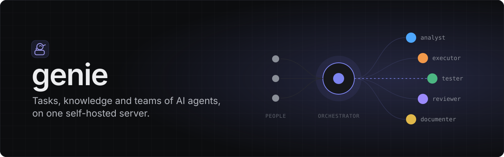

<p align="center">
  
</p>

**Genie** is a self-hosted workspace where people and AI agent teams share tasks and knowledge. A project manager shapes requirements and dispatches ready work within project autonomy. Each task has a manager (orchestrator) that delegates execution, routes clarifications, and publishes a mandatory retrospective after result acceptance. Each role has its own model, skills, and tool access.

[Documentation](https://grigoryshulga.github.io/genie/) · [Quick start](docs/platform/getting-started.md) · [Changelog](CHANGELOG.md)

## What it does

- Tasks and epics with acceptance criteria, dependencies, review, and human decisions.
- Agent teams in separate workspaces, with live conversations and recovery after restarts.
- GitHub/GitLab repositories, PRs/MRs, CI feedback, and server-enforced delivery policies.
- A Git-backed, Obsidian-compatible knowledge vault with search and publication review.
- Durable automations, Telegram/email notifications, usage tracking, and budgets.
- Web UI, CLI, and MCP access to the same operations; projects with or without code.

## Run with Docker

```bash
cp docker/.env.example docker/.env
docker compose -f docker/docker-compose.yml up -d --build
printf '%s\n' 'replace-with-a-strong-password' | docker compose -f docker/docker-compose.yml exec -T genie genie user add admin --admin --password-stdin
```

Open [localhost:7420](http://127.0.0.1:7420). Configure role models and provider keys in Settings before starting agents. See [Docker deployment](docs/platform/docker.md) for storage, network access, sandboxing, and updates.

## Build from source

Requires stable Rust, Node 22.19+, and Git. Linux agent isolation uses bubblewrap.

```bash
npm ci
npm run build:web
GENIE_WEB_DIST=web/dist cargo build --release -p genie
npm install -g @earendil-works/pi-coding-agent
pi  # /login to your model providers, then exit
./target/release/genie serve
```

The web build is embedded in the binary. Follow the [quick start](docs/platform/getting-started.md) to create an admin account, a project, and the first task.

## Documentation

| Need | Read |
| --- | --- |
| Understand the workflow | [Tasks and epics](docs/guide/tasks.md) |
| Understand project and task managers | [Management lifecycle](docs/platform/project-and-task-managers.md) |
| Configure agents | [Roles and teams](docs/platform/agent-roles-and-teams.md) |
| Connect a coding agent or terminal | [CLI and MCP](docs/reference/cli.md) |
| Operate the server | [Operations](docs/platform/operations.md) |
| Understand the implementation | [Architecture](docs/platform/backend.md) |
| Contribute or edit these docs | [Development](docs/development.md) |

All project documentation is in English. The site and repository use the same Markdown sources.

## Development

```bash
cargo test
cargo clippy --all-targets -- -D warnings
cargo fmt --all --check
npm test
npm run typecheck
npm run lint:web
npm run build:web
```

Run `npm run dev:web` for the web client; it proxies `/api` to port 7420. Rust tests generate API types in `web/src/shared/api/generated/`; commit updated types with their Rust changes.

For the documentation site:

```bash
npm ci --prefix docs
npm run docs:dev
```

The [development guide](docs/development.md) covers documentation checks and GitHub Pages deployment. Users of the removed pi extension can [migrate existing trackers in place](docs/platform/getting-started.md#migrate-from-the-pi-extension).
