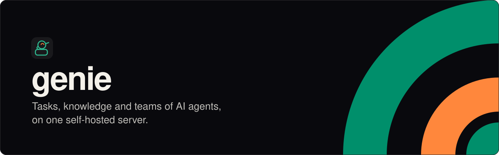

<p align="center">
  
</p>

**Genie** is a self-hosted workspace where people and AI agent teams share tasks and knowledge. A project manager shapes requirements and dispatches ready work within project autonomy. Each task has a manager (orchestrator) that delegates execution, routes clarifications, and publishes a mandatory retrospective after result acceptance. Each role has its own model, skills, and tool access.

[Documentation](https://grigoryshulga.github.io/genie/) · [Quick start](https://grigoryshulga.github.io/genie/platform/getting-started) · [Changelog](CHANGELOG.md)

## What it does

- Tasks and epics with acceptance criteria, dependencies, review, and human decisions.
- Agent teams in separate workspaces, with live conversations and recovery after restarts.
- GitHub/GitLab repositories, PRs/MRs, CI feedback, and server-enforced delivery policies.
- A Git-backed, Obsidian-compatible knowledge vault with search and publication review.
- Durable automations, Telegram/email notifications, usage tracking, and budgets.
- Web UI, CLI, MCP, and OpenAI-compatible project entrypoints; projects with or without code.

## Run with Docker

```bash
cp docker/.env.example docker/.env
docker compose -f docker/docker-compose.yml up -d --build
printf '%s\n' 'replace-with-a-strong-password' | docker compose -f docker/docker-compose.yml exec -T genie genie user add admin --admin --password-stdin
```

Open [localhost:7420](http://127.0.0.1:7420). Configure role models and provider keys in Settings before starting agents. See [Docker deployment](https://grigoryshulga.github.io/genie/platform/docker) for storage, network access, sandboxing, and updates.

## OpenAI-compatible project entrypoint

Set a client's base URL to `http://localhost:7420/openai/projects/<project>/v1`, use a personal Genie API token and select model `genie`. Each new conversation gets an independent agent with project knowledge and its own durable history. The `intake` role uses its configured model, or the project manager's configured model.

```python
import os
from openai import OpenAI

client = OpenAI(
    base_url="http://localhost:7420/openai/projects/my-project/v1",
    api_key=os.environ["GENIE_API_TOKEN"],
)
response = client.responses.create(
    model="genie",
    input="Prepare an order export and return the result for my approval.",
    background=True,
    extra_headers={"Idempotency-Key": "order-export-001"},
)
print(response.id, response.status)
# Retrieve later; continue a terminal response using previous_response_id.
print(client.responses.retrieve(response.id))
```

Supported: text Chat Completions and Responses, JSON and SSE, Responses background retrieval and cancellation. SSE sends keepalives while working, then the persisted final answer; it does not stream intermediate model tokens. Unsupported options, tools and modalities return an error. Retrying with the same `Idempotency-Key` and payload returns the same response; without a key, a new request is new work.

The default Pi harness receives request context through stdin. Custom `runtime.command` templates can use `{messageFile}` to read the full context without process argument limits; oversized `{message}` values become a reference to that private file and server commands for retrieving the context.

Continue with `previous_response_id` in Responses or the returned `X-Genie-Conversation` header in either API. An ordinary chat client can also send `/status <task>`, `/continue <task> <text>`, `/answer <task> <question-id> <text>`, or `/approve <proposal>` / `/reject <proposal>`; the server routes these to the requester's original conversation. Imported chat history supplies context, never authorization.

Each conversation has one primary task. Manual projects require an explicit dispatch approval. Result approvals bind to a specific task and artifact version; changed results need a new proposal. A completed response may report an ongoing task: later questions, artifacts and proposals remain available through `/status` or `GET /api/conversations/<conversation-id>` with `X-Genie-Project`. Cancelling a response stops its intake agent; already released tasks keep their own lifecycle.

## Build from source

Requires stable Rust, Node 22.19+, and Git. Linux agent isolation uses bubblewrap.

```bash
npm ci
npm run build:web
GENIE_WEB_DIST=web/dist cargo build --release -p genie
npm install -g @earendil-works/pi-coding-agent
pi  # /login to your model providers, then exit
./target/release/genie serve
```

The web build is embedded in the binary. Follow the [quick start](https://grigoryshulga.github.io/genie/platform/getting-started) to create an admin account, a project, and the first task.

## Documentation

| Need | Read |
| --- | --- |
| Understand the workflow | [Tasks and epics](https://grigoryshulga.github.io/genie/guide/tasks) |
| Understand project and task managers | [Management lifecycle](https://grigoryshulga.github.io/genie/platform/project-and-task-managers) |
| Configure agents | [Roles and teams](https://grigoryshulga.github.io/genie/platform/agent-roles-and-teams) |
| Connect a coding agent or terminal | [CLI and MCP](https://grigoryshulga.github.io/genie/reference/cli) |
| Operate the server | [Operations](https://grigoryshulga.github.io/genie/platform/operations) |
| Understand the implementation | [Architecture](https://grigoryshulga.github.io/genie/platform/backend) |
| Understand the domain language | [Glossary](https://grigoryshulga.github.io/genie/glossary) |
| Contribute or edit these docs | [Development](https://grigoryshulga.github.io/genie/development) |

All project documentation lives in the project's private knowledge vault and is published in English at the documentation site. Agents read their required pages from the vault; `AGENTS.md` points to them.

## Development

```bash
cargo test
cargo clippy --all-targets -- -D warnings
cargo fmt --all --check
npm test
npm run typecheck
npm run lint:web
npm run build:web
```

Run `npm run dev:web` for the web client; it proxies `/api` to port 7420. Rust tests generate API types in `web/src/shared/api/generated/`; commit updated types with their Rust changes.

For the documentation site, which is built from the vault:

```bash
npm ci --prefix site
npm run docs:vault   # clone or update the knowledge vault at site/.vault
npm run docs:dev
```

The [development guide](https://grigoryshulga.github.io/genie/development) covers documentation checks and GitHub Pages deployment. Users of the removed pi extension can [migrate existing trackers in place](https://grigoryshulga.github.io/genie/platform/getting-started#migrate-from-the-pi-extension).
