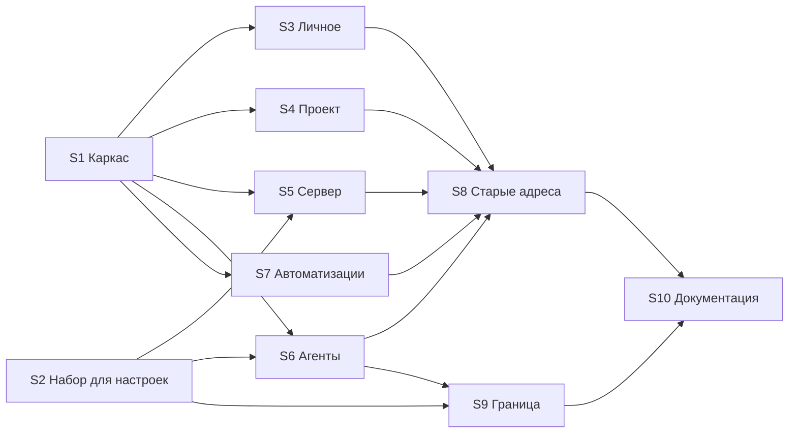

# Настройки и администрирование

Решения владельца — PD21–PD23 в [[platform/decisions]]. Связанные страницы: [[platform/agent-roles-and-teams]] (роли, шаблоны, MCP; PD13, PD14, PD20) и [[platform/git-repositories]] (репозитории, `git.json`).

## Почему

У genie две разные потребности. Одна — **работа**: задачи, эпики, команды, чаты агентов, знания. Ею занимаются все участники каждый день. Другая — **администрирование**: сервер, проекты, люди, роли агентов, подключения, секреты, каналы. Ею занимаются администраторы, и редко.

Сейчас эти потребности перемешаны:

- Настройки разбросаны по пяти местам: «Сервер», «Проект и люди», «Агенты», «Автоматизации», «Профиль». В трёх из них просмотр и правка живут на одном экране, а кнопки правки просто прячутся, если прав нет.
- Права на фронте только прячут кнопки. Проверка доступа на уровне маршрута одна — вход в систему (`Gate`). Права проверяет сервер, каждый обработчик отдельно (`ctx.server_admin()`, `Access::admin()`).
- У API нет пространства имён: `/api/users`, `/api/doctor`, `/api/mcp-admin` и `/api/vault/sync` лежат рядом с рабочими маршрутами.
- Большую часть настроек сервера из веба не поменять. Это весь `config.json` (адрес и хосты, `runtime.*`, песочница, бюджеты, лимиты, Telegram, SMTP, vault, LiteLLM) и `git.json`. Первого администратора, резервную копию, восстановление и миграции можно сделать только из терминала. `App.cfg` читается один раз при старте.
- Журнал изменений (`config_changes`) ведётся только для ролей, шаблонов, навыков и MCP. Кто создал пользователя, выдал права администратора или поменял политику репозитория, не записывается.

## Решение

Отдельный режим **«Настройки»** (`/settings`) в той же SPA. У него свой макет, своё меню и выход «← к работе». Разделы режима соответствуют уровням доступа.

**Правило разделения:** в рабочей части **пользуются и наблюдают**, в настройках **определяют и меняют**. Пример — каталог ролей. Посмотреть роль и собрать команду по шаблону — это работа. Изменить роль — это настройка.

| Раздел | Кто видит | Кто меняет | Что внутри |
|---|---|---|---|
| Личное | каждый | сам человек | аккаунт, вход и пароль, Telegram, провайдеры и ключи, токены CLI и MCP |
| Проект | участники проекта | администратор и владелец проекта | общие, работа агентов, репозитории, люди, правила автоматизаций |
| Сервер | администраторы сервера | администраторы сервера | состояние, статистика, проекты, учётные записи, роли, шаблоны, навыки, MCP, база знаний; после этапа 3 — параметры, каналы, git-хостинги, секреты, журнал |

Раздел «Проект» работает с текущим проектом сессии. В меню настроек есть переключатель проекта — тот же, что в боковой панели.

Сервер остаётся единственным, кто проверяет права. Фронт раскладывает экраны по правам, но защитой не является.

### Отвергнутые варианты

| Вариант | Почему нет |
|---|---|
| Отдельная SPA (`admin.html`) в том же бинаре | По безопасности даёт то же самое: границу держит сервер. Цена — второй shell, вторая сессия и второй `QueryClient`, а переход между частями перезагружает страницу. Изоляцию кода дают ленивый чанк и линтер границ (см. ниже), без двух приложений |
| Отдельный процесс или порт для админки | Отложено (PD23). Дешёвая его часть — необязательный `adminBind` для `/api/admin` — появится вместе с повторным входом для администраторов, когда будет SSO (Ф7) |
| Настройки проекта внутри рабочей части (как вкладка «Settings» у GitLab) | Владелец выбрал единый режим (PD21): разделение должно быть полным, а не только для сервера |

### На что ориентируемся

- [Linear Settings](https://linear.app/docs) — отдельный полноэкранный режим с разделами «личное / рабочее пространство / команды». genie задуман в стиле Linear.
- [Mattermost System Console](https://docs.mattermost.com/administration-guide/configure/configuration-settings) — `config.json` как источник правды, формы по описанию настроек. Настройки, заданные [переменными окружения](https://docs.mattermost.com/administration-guide/configure/environment-variables), в консоли заблокированы.
- [GitLab Admin area](https://docs.gitlab.com/administration/admin_area/) — отдельный раздел со своим меню и [Admin Mode](https://docs.gitlab.com/administration/settings/sign_in_restrictions/) (повторный вход).

## Карта адресов

| Было | Стало | Примечание |
|---|---|---|
| `/profile/:tab?` | `/settings/me/{account,security,telegram,keys,tokens}` | |
| `/project/:tab?` | `/settings/project/{general,agents,repos,people}` | участникам — только просмотр, как сейчас |
| — (редактор на `/automations`) | `/settings/project/automations` | правила, плейбуки, включение, удаление |
| `/automations` | `/automations` | только использование: список правил, «Запустить», запуски, отмена |
| `/server/:tab?` | `/settings/server/{health,stats,projects,accounts,mcp,vault}` | |
| редакторы на `/agents` | `/settings/server/{roles,templates,skills,history}` | |
| `/agents` | `/agents` | каталог только для чтения; администратору — ссылка «Настроить» |

Старые адреса перенаправляются на новые: ссылки хранятся в уведомлениях (`notifications.link` в `server.db`) и в закладках. Так уже сделано для старых адресов списка (`LegacyView`).

## Этапы

| Этап | Что | Меняется ли API |
|---|---|---|
| 1 | Режим «Настройки», перенос экранов, разделение «Агентов» и «Автоматизаций», граница в коде | нет |
| 2 | Экстракторы `ServerAdmin` и `ProjectAdmin` вместо проверок в теле обработчиков. Пространства имён `/api/admin/*` и `/api/projects/{slug}/settings/*` с переносом всех вызовов: веб, `ops/*`, тесты. Единый журнал администрирования: `config_changes` для пользователей, прав, проектов, участников, репозиториев, политик и секретов | да, без старых путей |
| 3 | Параметры сервера в вебе. `Config` перезагружается так же, как `AgentConfig`. Схема строится из Rust-структур (`schemars`) с подсказками для интерфейса: группа, «применяется сразу» или «нужен перезапуск», секрет. У каждого значения виден источник (по умолчанию, `config.json`, env); то, что задано через env, заблокировано. Секреты каналов и провайдеров запечатаны в `server.db` и подставляются по ссылке `${secret:…}`. `git.json` правится там же. Есть кнопка «Перезапустить» (PD22). Для CLI и MCP — операции `genie server config …` (PD18) | да |
| 4 | Мастер первого запуска по одноразовому токену из журнала вместо `genie user add admin`. Резервная копия из веба. Повторный вход для администраторов и `adminBind` (PD23) | да |

### Перезапуск кнопкой (этап 3)

1. Сервер завершается так же аккуратно, как по SIGTERM, и выходит с отдельным **ненулевым** кодом, зарезервированным под «перезапуск просили» (нулевой не годится: systemd с `Restart=on-failure` чистый выход не поднимает).
2. Поднимает его супервизор — существующие деплои менять не нужно:
   - systemd: `Restart=on-failure` (`deploy/systemd/genie.service`) перезапускает любой ненулевой выход, `RestartSec=5` даёт паузу;
   - Docker: `restart: unless-stopped` перезапускает любой выход.
3. Если супервизора нет (просто `genie serve`), кнопка недоступна, а интерфейс говорит, что перезапустить надо вручную. Как именно определять супервизор — решается на этапе 3.

## Этап 1: задачи

Этап 1 не трогает API и права на сервере, поэтому не меняет, кто что может. Работа идёт в ветке `genie/G-136`; база ветки уже содержит вкладку MCP (PD20, коммит `feature/mcp-ui`) — отдельного предусловия нет.

После S1 и S2 задачи S3–S7 идут параллельно.

### S1. Каркас режима «Настройки»

- **Маршруты.** `Gate` отдаёт `<Outlet/>` с двумя макетами: рабочим (нынешний `Shell`) и `SettingsShell` на `/settings/*`. `useLiveUpdates` переезжает на уровень `Gate`, чтобы при переходе между режимами было одно соединение SSE, а не два.
- **`SettingsShell`.** Слева меню: «Личное», «Проект» с переключателем проекта, «Сервер». Пункты показываются по правам из `useSession` и роли в проекте. Есть «← к работе», которая возвращает на последний рабочий адрес. Справа — содержимое раздела. Режим — отдельный ленивый чанк.
- **Охрана раздела «Сервер»** на уровне маршрута: не-администратор видит пояснение, а не пустые вкладки. `/settings` открывает `/settings/me/account`.
- **Вход в режим:**
  - шестерёнка в подвале боковой панели (сейчас ведёт на `/profile`);
  - то же в `MobileNav`;
  - сочетание `G` затем `S` (буква `s` свободна);
  - пункт «Настройки» в палитре команд.
- **Готово, когда:** `/settings` открывается с меню по правам; администратор сервера, администратор проекта, участник и локальный режим видят свои разделы; из любого рабочего экрана в настройки и обратно можно попасть без перезагрузки; в сетевой панели одно соединение `/api/events`.

### S2. Общий набор для настроек

- **Что перенести:**
  - из `pages/agents/ui/common.tsx`: `Section`, `Badge`, `Problems`, `CodeArea`, `FileEditor`, `History`;
  - `useAct` — он сейчас дублируется в `ProjectPage.tsx` и `ProfilePage.tsx` и должен остаться в одном экземпляре;
  - `Menu.tsx` и `BarChart.tsx` из `pages/project`.
- **Куда:** то, что не знает о сущностях, — в `shared/ui`; то, что знает (например, `FileEditor` и `History` поверх `entities/agent-config`), — в `widgets/settings-kit`.
- **Готово, когда:** ни одна страница не импортирует `@/pages/agents/ui/common.tsx` и `./ProjectPage.tsx` ради общих частей; `useAct` один.

### S3. Раздел «Личное»

- Вкладки `ProfilePage` становятся пунктами `/settings/me/*`. Маршрут `/profile` удаляется.
- **Готово, когда:** все пять вкладок работают по новым адресам, а локальный режим показывает ту же подсказку, что сейчас.

### S4. Раздел «Проект»

- Вкладки `ProjectPage` («Общие», «Работа агентов», «Репозитории», «Люди») становятся `/settings/project/*`. Поведение для администраторов и участников прежнее: участник видит, но не меняет. `FirstAdmin` в локальном режиме остаётся во вкладке «Люди». `window.location.assign("/project")` после создания администратора ведёт на новый адрес.
- Пункт «Проект и люди» и маршрут `/project` удаляются.
- **Готово, когда:** смена проекта в меню настроек меняет проект и в рабочей части; ссылка «Настроить во вкладке «Репозитории»» ведёт по новому адресу.

### S5. Раздел «Сервер»

- Вкладки `ServerPage` становятся `/settings/server/*`. `McpAdminSection` больше не импортирует из `pages/agents` (это закрывает S2). `FirstProjectPage` остаётся в `Gate`.
- Пункт «Сервер» и маршрут `/server` удаляются.
- **Готово, когда:** все вкладки доступны; ссылка «Вся статистика» и ссылка «Управление подключениями» из каталога MCP ведут по новым адресам.

### S6. Агенты: каталог и редакторы

- `/settings/server/{roles,templates,skills,history}` — нынешние экраны правки:
  - редакторы файлов;
  - разрешения;
  - диалоги рабочего места, навыков и MCP;
  - «Новая роль», «Новый шаблон», «Новый навык»;
  - «Вернуть по умолчанию»;
  - история с откатом.
- `/agents` — каталог для всех, только для чтения:
  - роли, шаблоны (граф, предпросмотр kickoff), навыки, MCP (список и журнал вызовов);
  - нет ни одного элемента правки, даже у администратора;
  - у администратора у каждого элемента ссылка «Настроить» на тот же элемент в настройках.
- **Ссылки:**
  - на роль и шаблон из рабочих экранов (`AgentChat.tsx:559`, `TeamView.tsx:166`) ведут в каталог;
  - перекрёстные ссылки внутри редакторов (`RolesTab`, `TemplatesTab`, `LibraryTabs`) ведут в настройки.
- **Готово, когда:** в `pages/agents` нет кода правки (`useSaveConfig`, `FileEditor`, `disabled={!admin}`); администратор правит роль в настройках, а каталог обновляется по SSE.

### S7. Автоматизации: использование и правила

- `/settings/project/automations` — список правил, редактор JSON, плейбуки, включение и выключение, удаление.
- `/automations` — список правил (название, триггер, последний запуск), «Запустить» (сервер требует только `write`), запуски по всем правилам и по одному, отмена.
- Ссылки `/automations?rule=` из `RolesTab` и `TemplatesTab` ведут в настройки.
- **Готово, когда:** в `/automations` нет «Нового правила», плейбуков и редактора; участник проекта по-прежнему запускает и отменяет.

### S8. Старые адреса и ссылки сервера

- **Перенаправления:** `/profile/*`, `/project/*` и `/server/*` ведут на новые адреса с той же вкладкой.
- **Ссылки в уведомлениях, которые формирует сервер:** `llm_key.rs:204` (`/profile/keys`) и `vault_sync.rs:296` (`/server`) указывают на новые адреса.
- **Остальное:** список `platformRoute` в `Shell` (`App.tsx:60`) больше не содержит удалённых маршрутов.
- **Готово, когда:** старое уведомление со ссылкой `/profile/keys` открывает `/settings/me/keys`; `cargo test` и веб-тесты проходят.

### S9. Граница в коде

- Подключить [Steiger](https://github.com/feature-sliced/steiger) только с правилом [`fsd/forbidden-imports`](https://github.com/feature-sliced/steiger/blob/master/packages/steiger-plugin-fsd/src/forbidden-imports/README.md): срезы одного слоя не импортируют друг друга, нижние слои не импортируют верхние.
- Добавить скрипт `npm run lint:web` и шаг в задаче `web` в CI.
- Исправить нарушения, которые уже есть:
  - `McpAdmin.tsx` → `pages/agents` — закрывается задачей S2;
  - `TaskPage.tsx` → `pages/team` — `TeamView` переезжает в `widgets/team-view`.
- **Готово, когда:** `npm run lint:web` чистый в CI, а импорт из `pages/settings-*` в рабочую страницу роняет проверку.

### S10. Документация и журнал изменений

- **Что обновить:**
  - `getting-started.md:57,72–74,109,153,322,359,363`;
  - `docker.md:174,195`;
  - `pilot.md:22,41,118,137,140`;
  - `agent-roles-and-teams.md:280,440`;
  - PP18 в [[platform/decisions]];
  - `README.md:43`;
  - запись в `CHANGELOG.md`.
- **Готово, когда:** в документации не осталось «страница «Сервер»», «Проект и люди» и «Профиль» в старом смысле.

### Проверка этапа 1

Сначала `npm test`, `npm run typecheck`, `npm run build:web`, `npm run lint:web` и `cargo test`. Затем ручной прогон в браузере четырьмя пользователями: администратор сервера, администратор проекта, участник, локальный режим. Каждый проходит все разделы настроек и рабочие экраны. Проверить:

- что видно и что меняется;
- что работают старые адреса;
- что в рабочей части нет ни одного элемента правки настроек.
